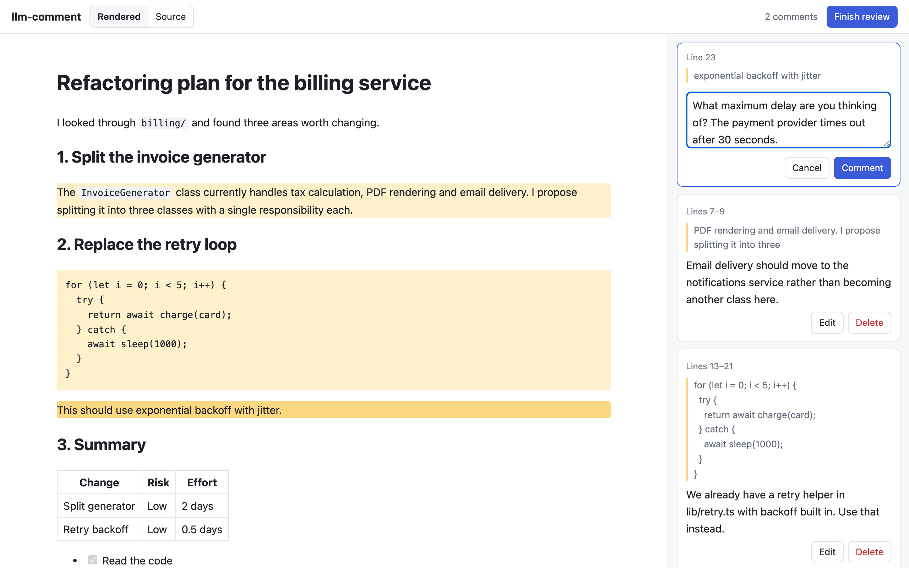

# llm-comment

Review what your AI agent wrote the way you'd review a pull request: select passages, leave inline comments, then
hand them back to the agent to act on.



llm-comment opens the agent's output in a local web page, collects your comments, and returns them as JSON tied to
the exact text you selected. It comes with a Claude Code skill that runs the whole loop for you, and the CLI can be
driven by any agent that can run shell commands. Requires Node.js 24 or later.

## Claude Code skill

### Install

Run this in Claude Code, from any directory. There's no need to clone this repo, which doubles as a plugin
marketplace:

```sh
/plugin install llm-comment --marketplace GeekFiftyFive/llm-comment
```

This installs the skill for all your projects. Add `--scope project` to record it in the current project's
`.claude/settings.json` instead, so collaborators are offered it too. On Claude Code versions before 2.1.275, add the
marketplace first with `/plugin marketplace add GeekFiftyFive/llm-comment`, then run
`/plugin install llm-comment@llm-comment`.

You don't need to install the CLI separately: the skill uses `llm-comment` if it's on your `PATH`, and otherwise runs
a pinned version with `npx`.

### Use

When Claude has written something you want to give feedback on, such as a plan, a design or a draft, run:

```sh
/llm-comment:review-output
```

Or just ask, for example "let me comment on that". To review something other than Claude's last response, say what:
`/llm-comment:review-output the migration plan`, or give a file path.

1. Claude saves its response to a file and opens it in your browser.
2. Select any passage and add a comment. You can switch between the rendered view and the Markdown source, and edit
   or delete comments as you go.
3. Click **Finish review**. Claude receives your comments, works through each one, and tells you what it changed.

## CLI usage

```sh
# Foreground: blocks until the user clicks "Finish review", then prints the comments JSON.
npx -y llm-comment@0.1.0 open /path/to/output.md --wait

# Background: prints {"session":"…","url":"…"} and exits immediately.
npx -y llm-comment@0.1.0 open /path/to/output.md
# Later: print the comments and stop the background server.
npx -y llm-comment@0.1.0 comments <session>
```

Options for `open`: `--no-open` (don't launch a browser), `--port <n>`, `--timeout <minutes>` (idle timeout, default
120). The server also stops when the review is finished.

Output:

```json
{
  "version": 1,
  "document": { "sha256": "…", "lines": 31 },
  "status": "done",
  "comments": [
    {
      "id": "…",
      "startLine": 7,
      "endLine": 9,
      "quote": "selected text",
      "comment": "…",
      "createdAt": "…"
    }
  ]
}
```

`status` is `"open"` if the review timed out or `comments` was run before the user finished.

## Security model

- The input file is copied into a private `mkdtemp` session directory (mode 0700). The server only reads and writes
  fixed files in that directory; no request ever carries a path.
- Listens on `127.0.0.1` only, on a random port. Requests with any other `Host` header are refused (DNS rebinding).
- Every API request needs a per-session bearer token, delivered in the URL fragment so it never reaches logs or
  `Referer`. No CORS headers are sent; writes also check `Origin`/`Sec-Fetch-Site` and only JSON bodies are accepted.
- Request bodies are schema-validated and size-limited.
- The document is rendered without raw HTML, remote images are blocked, and a strict CSP is applied.

## Development

```sh
npm run build        # compile the CLI and bundle the frontend into dist/
npm run typecheck    # tsc over src, test and web
npm test             # unit tests
npm run test:e2e     # builds, then drives the real CLI
npm run lint         # oxlint
npm run format       # oxfmt (format:check to check without writing)
```

Git hooks are managed by [Lefthook](https://lefthook.dev) and installed by `npm install`. Before each commit they
lint and format-check the staged files and run the unit tests; before each push they lint and format-check the whole
project, typecheck, and run the unit and end-to-end tests. Skip them once with `LEFTHOOK=0`.

Frontend with live reload: run `npm run dev:server` (serves `example.md` on port 4100 and prints a URL with a token),
then `npm run dev:web` and open `http://localhost:5173/#token=<token from the first command>`.

To try the skill against your working copy, run `npm link` (puts `llm-comment` on your `PATH`, pointing at `dist/`),
then start Claude Code with `claude --plugin-dir ./plugin`. Check manifests with `claude plugin validate .`.

Every pull request to `main`, including drafts, runs lint, format check, typecheck, build and all tests in CI
(`.github/workflows/ci.yml`). For publishing new versions, see [docs/RELEASING.md](docs/RELEASING.md).

Jest runs under `node --experimental-vm-modules` so it can load Fastify's ESM-only dependencies. TypeScript 7 has no
compiler API for ts-jest, so tests are transpiled with SWC and type-checked separately by `npm run typecheck`.
